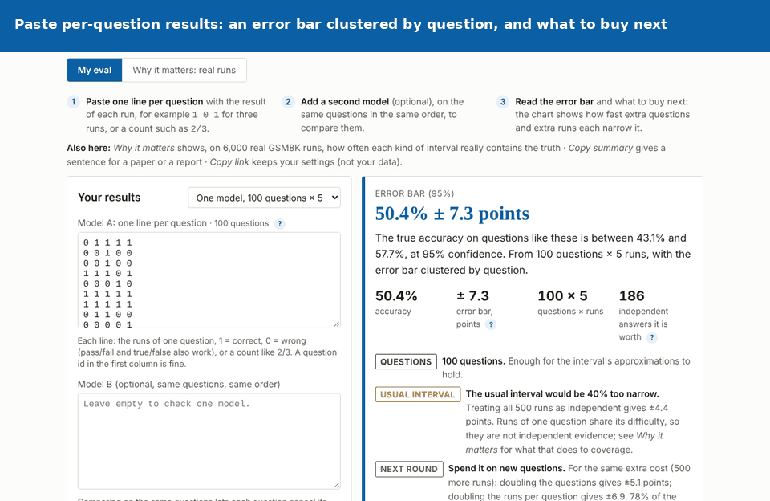
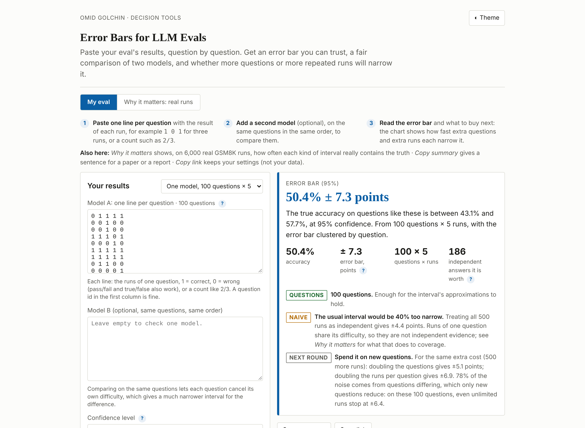
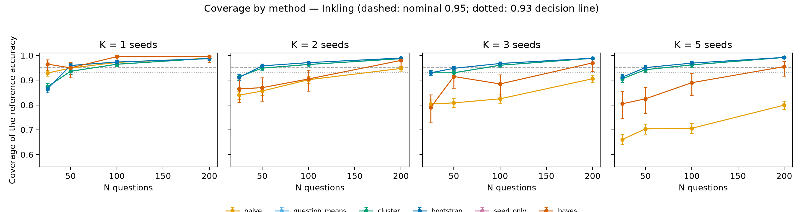
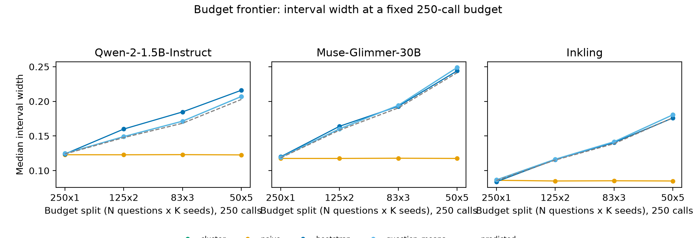

# Error Bars for LLM Evals

For anyone who reports an LLM eval score: paste your results, one line per question, and get an error bar you can trust, a fair comparison of two models on the same questions, and whether your next runs should go to more questions or to more repeats of the same ones.





**Use it:** https://omidgolchin.github.io/llm-eval-error-bar/ (runs in your browser; your results are never uploaded)

## What it does

- **My eval.** Paste per-question results (`1 0 1` for three runs, `pass fail`, or a count like `2/3`). You get the accuracy with an error bar clustered by question (cluster-robust standard error, t interval with N−1 degrees of freedom), the naive interval for contrast and how much too narrow it is, and how many independent answers your runs are really worth.
- **Two models.** Add a second model's results on the same questions and get the paired difference with its interval, and how much narrower pairing makes it than comparing the two scores separately.
- **What to buy next.** From your own runs, the noise is split into question difficulty (σ²q) and run-to-run flips (σ²w); the chart shows how fast the error bar narrows if the next runs go to new questions or to repeats, and the floor that repeats can never get below.
- **Why it matters: real runs.** The second mode shows the evidence: on 6,000 real GSM8K runs, how often each interval method actually contains the model's true accuracy, and how a fixed budget is best split.
- **Copy summary / Copy link.** A sentence for a paper or a report (estimate, interval, design, method), and a link that keeps your settings; your results stay on your device.
- **Help where you need it.** Each mode opens with three steps saying what to enter and what you get; every input has a line under it; and every technical term has a **?** that opens a plain-language explanation.

The calculator (`docs/evalbar.js`) is checked against this repository's Python package on random matrices (`tests/test_evalbar_js.py`): the same intervals to four decimals, the same variance components, and t quantiles within 0.2% of scipy.

## The study behind it

The interval everyone reaches for (pool all N × K runs and take a
Wilson interval) covers the true accuracy only **0.69 to 0.80** of
the time at the common 50 questions × 5 runs design, against a 95%
nominal level, and it gets *worse* as you add runs. Given a fixed
250-call budget, 250 questions × 1 run beats 50 × 5 on interval
width for every model tested.

I built this to learn how evaluation uncertainty actually works:
run real models repeatedly, build several interval methods, and
check each one against a known reference: subsample the runs
2,000 times per design and count how often the interval contains
the truth. The methods that respect the question-level structure
(cluster-robust, question-means, two-stage bootstrap) hold up; the
pooled one does not, because repeated runs on the same question are
not independent data.

**Credit where it is due:** clustering uncertainty by question is
the recommendation of Miller (2024), “Adding Error Bars to Evals:
A Statistical Approach to Language Model Evaluations”
(arXiv:2411.00640). This project follows that recommendation; it
did not originate it. What this project adds is an empirical
coverage check of several interval methods on real model runs (not
only simulated data), a hierarchical Bayesian interval compared on
the same runs, practical budget guidance for splitting a fixed
number of calls between questions and runs, the reusable
`errorbars.intervals` function, and the tool above. In the tables
below, "seeds" means repeated runs of the same question.

## The question

When an LLM is evaluated on N questions with K repeated runs per
question, which interval methods actually cover the true accuracy
at their nominal 95% level, and how should a fixed budget of calls
be split between more questions and more seeds?

The primary estimand is the population accuracy over questions
like these, averaged over the model's sampling randomness. One
method below (seed-only) targets a different estimand — accuracy
on these exact questions — and is always labelled as such.

## Design

- **Benchmark:** GSM8K test split (1,319 questions), one fixed
  zero-shot chain-of-thought prompt, gold = the number after `####`.
- **Reference pool:** 400 questions sampled once with fixed seed
  20261112, shared by all models and all analyses. A model's
  reference accuracy is its mean over the full 400 × 5 grid.
- **Models** (chosen by pilot accuracy in a 45–85% band, three
  families): Qwen-2-1.5B-Instruct (reference accuracy 0.4945),
  Muse-Glimmer-30B (0.6480), Inkling (0.8615) — via Together AI
  serverless, temperature 0.7, top_p 1.0, max_tokens 512.
- **Main run:** 400 × 5 × 3 = 6,000 calls, $3.91 at pilot-time
  catalog prices (pilots $0.76; total project spend $4.67, see
  SPEND.md). 5 calls failed (API timeouts) and were graded
  incorrect per the frozen failure policy.
- **Coverage study:** for each model and each design
  N ∈ {25, 50, 100, 200} × K ∈ {1, 2, 3, 5}, 2,000 subsamples of
  the run matrix; coverage = share of subsamples whose interval
  contains the reference accuracy, reported with a Monte Carlo
  95% interval and the median width. The Bayesian method, being
  MCMC, uses the first 200 subsamples per design.
- **Frozen plan:** the design, methods, and decision rules were
  frozen in PLAN.md (with a SHA-256 freeze manifest) before the
  main run, and no definition was changed afterwards — the
  amendment log is empty.

## Headline results: coverage at 50 × 5

Nominal level 0.95 throughout. “Under-covers” is the frozen
decision rule (PLAN.md §9): coverage below 0.93 with the Monte
Carlo interval excluding 0.95.

| Method | Qwen-2-1.5B | Muse-Glimmer-30B | Inkling |
|---|---|---|---|
| Naive — pooled Wilson | **0.796** (w 0.123) UNDER | **0.689** (w 0.117) UNDER | **0.704** (w 0.085) UNDER |
| Question means + t | 0.962 (w 0.208) | 0.957 (w 0.249) | 0.943 (w 0.181) |
| Cluster-robust by question | 0.962 (w 0.208) | 0.957 (w 0.249) | 0.943 (w 0.181) |
| Two-stage bootstrap | 0.970 (w 0.216) | 0.963 (w 0.244) | 0.951 (w 0.176) |
| Hierarchical Bayesian | 0.965 (w 0.190) | 0.940 (w 0.206) | **0.825** (w 0.165) UNDER |
| Seed-only (different estimand) | 0.608 (w 0.085) UNDER | 0.334 (w 0.049) UNDER | 0.288 (w 0.033) UNDER |

(w = median interval width. Full tables for all 16 designs per
model, with Monte Carlo intervals, are in results/summary.md and
results/coverage_*.csv.)



### More seeds make the naive interval worse

At K = 1 the pooled interval is fine — it really is N independent
answers. Each added seed narrows the interval (more “data”) without
adding question-level information, so coverage falls:

| Naive coverage at N = 50 | K = 1 | K = 2 | K = 3 | K = 5 |
|---|---|---|---|---|
| Qwen-2-1.5B | 0.968 | 0.916 | 0.876 | 0.796 |
| Muse-Glimmer-30B | 0.971 | 0.882 | 0.811 | 0.689 |
| Inkling | 0.949 | 0.857 | 0.809 | 0.704 |

Across all designs, the naive method under-covers in 9 of 16
designs for Qwen, 11 of 16 for Glimmer, and 12 of 16 for Inkling
(counted from results/coverage_*.csv under the §9 rule).

### Two honest surprises

- **The Bayesian interval under-covers for Inkling** (0.825 at the
  default design; 9 of 16 designs), while behaving well for the
  other two models. Inkling combines high accuracy with very
  little within-question variance (σ²_w = 0.023), and the
  hierarchical posterior for the population mean is apparently
  over-tight there. Reported as-is; no post-hoc fix was attempted.
- **Seed-only is an estimand mismatch, not just a bad interval.**
  Against population accuracy it covers 0.29–0.61 at the default
  design — but against its own fixed-question estimand (these
  questions, new seeds) it covers 1.000 for all three models. It
  answers a different question than the one evaluators usually ask.

## Budget guidance: spend the budget on questions

At a fixed budget of 250 calls, the cluster method's median width
by split (predicted widths from the variance components track
these closely — see results/figures/fig_pred_vs_emp_se.png):

| Split | Qwen-2-1.5B | Muse-Glimmer-30B | Inkling |
|---|---|---|---|
| **250 × 1** | **0.125** | **0.119** | **0.087** |
| 125 × 2 | 0.149 | 0.160 | 0.116 |
| 83 × 3 | 0.171 | 0.194 | 0.142 |
| 50 × 5 | 0.207 | 0.249 | 0.181 |

Widths roughly double from 250 × 1 to 50 × 5. The reason is in
the variance components: an estimate's variance is
σ²_q/N + σ²_w/(N·K), and between-question variance dominates
within-question variance for Glimmer (0.180 vs 0.049) and Inkling
(0.097 vs 0.023). Qwen is the closest call (0.105 vs 0.146) and
250 × 1 still wins. Extra seeds only shrink the second term;
extra questions shrink both. The naive interval's width barely
changes across splits — that is the bug, not a bargain.



## Paired model differences

Both models on the same questions and seeds (matched 400 × 5
grid). The clustered intervals are wider than the naive one —
and the naive paired interval under-covers (0.85–0.88 at the
default design, vs 0.95–0.98 for the clustered methods):

| Pair | Estimate | Paired cluster 95% | Paired bootstrap 95% |
|---|---|---|---|
| Qwen − Glimmer | −0.153 | [−0.195, −0.112] | [−0.197, −0.107] |
| Qwen − Inkling | −0.367 | [−0.405, −0.329] | [−0.406, −0.324] |
| Glimmer − Inkling | −0.213 | [−0.248, −0.179] | [−0.249, −0.177] |

The ranking Inkling > Glimmer > Qwen is unambiguous under the
clustered methods.

## What I learned

- An interval is a claim about a sampling process. Pooling
  repeated runs breaks the claim silently: nothing in the pooled
  output looks wrong, the interval just quietly covers 0.70
  instead of 0.95.
- “More data” is not the same as “more information”. Five runs of
  one question mostly re-measure the same question; the binding
  constraint is question-level variation, so budget follows it.
- Every method has an estimand, and some failures are really
  mismatches: the seed-only interval is a correct answer to a
  question nobody meant to ask.
- A method can be principled and still miss: the hierarchical
  Bayesian interval was the most careful construction here and
  still under-covered the highest-accuracy model.

## Methods in brief

Exact definitions are frozen in PLAN.md §8; the code is
`src/errorbars/intervals.py` (`intervals()` and
`paired_intervals()`).

- **Naive:** Wilson interval on the pooled proportion, all N·K
  answers treated as independent.
- **Question means + t:** per-question mean accuracy, t-interval
  over the N means.
- **Cluster-robust:** pooled mean, sandwich standard error
  clustered by question (N/(N−1) correction), t critical value.
- **Two-stage bootstrap:** resample questions, then seeds within
  each question; percentile interval over 2,000 draws.
- **Hierarchical Bayesian:** logistic model with a question
  random effect (μ ~ N(0, 1.5), σ ~ HalfNormal(1.5), NumPyro
  NUTS); interval for the population accuracy
  E[logit⁻¹(μ + u)].
- **Seed-only:** within-question binomial variance only;
  questions fixed (different estimand, see above).

## Limitations

- **One benchmark:** GSM8K only, under this one prompt. Results
  may not transfer to other benchmarks, prompts, or sampling
  settings.
- **Three models,** chosen for mid-range pilot accuracy;
  coverage behaviour at accuracy near 0 or 1 is out of scope by
  design. (Inkling's reference accuracy, 86.2%, in fact landed
  just above the selection band.)
- **Finite reference pool:** “truth” is the mean over
  400 questions × 5 seeds, not the population value. Subsamples
  are drawn from that finite pool, so at large N the subsampling
  distribution is narrower than sampling fresh questions would
  be — coverage at large N is conservative in that specific way,
  and N/400 is reported alongside in the full results.
- **Output behaviour is part of one model's difficulty:**
  Muse-Glimmer-30B had a 31.6% parse-failure rate on the main run
  (mostly empty or truncated text at the 512-token cap), so part
  of its measured inaccuracy is output behaviour, not question
  difficulty. Parse failures are reported per model in
  results/summary.md.
- **Bayesian coverage** rests on 200 subsamples per design, so
  its Monte Carlo intervals are wider than the other methods'.

## Reproduce

```bash
python3 -m venv .venv
.venv/bin/pip install -r requirements.txt
.venv/bin/pip install -e .
.venv/bin/python -m pytest              # the test suite
.venv/bin/python -m errorbars.analyze   # regenerate results/ from outputs/
```

The analysis step needs no Together API key and makes no model
calls: it rebuilds `results/summary.md`, the coverage / paired /
budget CSVs, and all figures from `outputs/raw_runs.jsonl`. Two
honest caveats: that raw-runs file (6,000 rows) is not in git
(see `.gitignore`) and must be present in `outputs/`, and the
GSM8K dataset is downloaded once from Hugging Face and then
cached. Bayesian rows resolve from `results/bayes_cache/` when
present; delete the cache and they are recomputed by MCMC, which
is slow (hours, not minutes).

Re-running the model calls themselves is the command frozen in
PLAN.md §5; it needs a Together API key in `TOGETHER_API_KEY`
and cost $3.91 at pilot-time prices. It is not needed to
reproduce any number in this README.

## References

- Miller, E. (2024). “Adding Error Bars to Evals: A Statistical
  Approach to Language Model Evaluations.” arXiv:2411.00640.
- Cobbe, K. et al. (2021). “Training Verifiers to Solve Math
  Word Problems” (GSM8K). arXiv:2110.14168.

By Omid Golchin. MIT-licensed (LICENSE).
